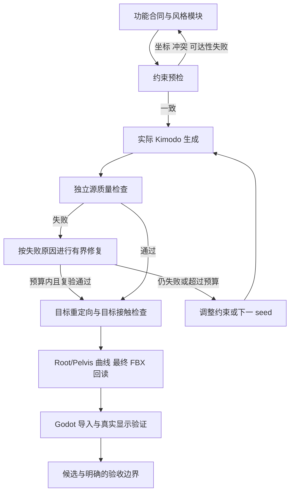

# 可替换风格的普通移动制作方法

本文定义动作风格改变时的制作流程。能否交付由实际生成、源检查、目标骨架、最终 FBX 和消费运行共同决定；不能由提示词文本、约束回执或某一个阶段的通过单独决定。当前批次的成功范围与失败清单另见验证记录。

每个资产独立保留证据；一条分支失败不阻止其他已经完成的分支继续转换。达到重试上限仍失败的分支保留缺失，不能以旧动作充当本轮成功。

## 0. 先确认检查测量的量

开始修动作前，用不可变原生动作作正控，并用错误速度、悬空、滑步、姿态断裂及错误来源作负控。检查坐标系、单位、帧率、实际插值、采样时间、角色骨长和真实蒙皮。检查器自己缺少有效参考样本时，要明确报告前提不成立，不能将缺样本当作零滑步。

当前 ALS 参考的 Sprint 和 Sprint_Acceleration 都是 0.6 秒循环，速度分别为 6 和 5 m/s，使用前脚掌支撑。Acceleration 名称不等于从站立起跑。Walk_Backward 是另一个方向合同，不应因名字未登记而跳过目标修复。

SOMA 源骨架的脚跟属于估计代理；目标骨架的原生几何和游戏中实际蒙皮另行测量。源检查中的接缝速度是离散端点割线速度差，原生快动作也可能不满足其较严格的平滑要求。原生目标通过可以提供独立约束相位，但不会把源审计失败改为通过。详见[接缝门禁诊断](../verification/2026-10-13-seam-gate-diagnosis.md)。

预算要对应同一帧、同一骨、同一脚或同一骨盆的实际修改路径。不同位置的阶段最大值相加可高估总修改；只看最终净位移又会隐藏往返修改。不得通过扩大数值门限、隐藏失败样本或复制原生资产来取得通过。

## 1. 功能合同与风格文本分开

功能合同固定动作、方向、速度、周期、站蹲和接触类型。风格文本控制背／头、手臂动作和整体表现。改变风格时先保持功能合同不变；如果要求从行走改成跳跃、由站立改为低蹲，必须同时重新选择功能合同。

`prompt_modules.py` 将动作、方向、相位、站蹲、姿态、手臂和风格组织为独立模块。支持明确增删、继承、按站蹲选择描述、意图冲突检查及有效内容摘要。示例在 `prompt_module_examples.json`。生产 DAG 保存实际合成的英文文本及模块回执；图中明确方向与提示词方向矛盾时拒绝计划。

更换风格后还要审查旧的强制上身后处理和全身关键帧。将手臂固定的后处理与要求摆动大臂的文本同时启用属于冲突。三种实验风格分别为中性、固定大臂／摆动小臂的柔和风格、自然摆臂的运动风格；这些名称不替代人工风格验收。

对照时固定模型、骨架、seed、时长、步数、CFG 和约束，只改一个文本因素。先比较基线与模块增删，再用其他 seed 检查重复性。官方建议从主体和明确动作开始，保持中等细节；复杂的每关节控制应由约束承担。[Kimodo 提示词与约束建议](https://research.nvidia.com/labs/sil/projects/kimodo/docs/key_concepts/limitations.html)

## 2. 按失败类型增加最少的生成条件

方向或平均位移错误使用 `root2d`；支撑不稳定使用测量得到的脚部相位与落脚点；骨盆高度或旋转不可靠时增加 Hips 条件；周期上身不能闭合时，可用同一风格真实生成的上身姿态提供稀疏周期边界，不能默认借用原生上身覆盖风格。

`constraint_phase.py` 从通过原生目标门禁的参考中提取实际接触和周期，并重验原生文件、投影脚尖、骨架及参考动作摘要。它只授权建立约束或有界修复计划，`referenceAcceptedAsMaster` 始终为 false。生成结果仍通过独立源检查。

`poseConstraintMode` 明确选择 `feet_only`、`lower_body` 或 `full_body`。越多关键帧会越强地限制生成自由；必须记录实际约束的骨骼、相位和数量，并遵循每种稀疏约束少于 20 帧的限制。针对不同速度可增加摆动脚相位，但不能把一个约束配置假定为所有动作都有效。

平滑 Root 轨迹与实际 Hips 位置是不同的量。`smooth_root_2d` 表示角色整体行进，`root_positions` 参与实际关节 FK；两者可以包含骨盆周期偏移。条件构造必须保留明示的二者关系，并核对已安装 Kimodo 的后处理是否会改写该关系。[Kimodo 约束格式与坐标说明](https://research.nvidia.com/labs/sil/projects/kimodo/docs/user_guide/constraints.html)

可选 `preserveReferencePelvisPath` 已实现这项分离，显式保留经过原生相位证据验证的骨盆残差，同帧数据和后端提取结果分别核对，不能把旧的 hips／smoothRoot 差值阈值简单调大。实现边界见[骨盆路径约束](kimodo-pelvis-path-constraints.md)。

可选的[生成风格参考](kimodo-style-constraint-reference.md)只借用本次实际 discovery 的上身，保留原生参考的 Root、Hips、腿和脚 FK。它仍是不可交付的参考；必须再次运行 Kimodo，不能把合成参考本身导出为新生成结果。

## 3. 后处理只修可界定的误差

多周期候选可按[单周期制作流程](kimodo-single-loop-crop.md)选一完整周期。`loop_crop` 保存选段与行进逆变换，先修接触，再在最终时间域重建小臂等周期通道，最后固定端点、匹配切线并用局部 Easing 修复接缝，再按原阈值验收。全身平滑会破坏支撑时，可启用联合脚部锚点／清地／边界切线求解；通过后仅复核风格，不重复重建小臂。原始接缝用于诊断，不在修复前阻断；最终仍联合检查支撑／穿地与风格。重复播放只证明边界行为，不替代原生成稳定性或源／目标／最终文件／运行验收。

顺序为：选择有证据的完整周期，按原角度预算进行周期拟合，建立独立接触计划，保持落脚点进行固定骨长 IK，处理脚跟／脚尖清地，再执行原源门禁。不要在修复前用完整的输出质量标准拒绝本来可以在原预算内修好的输入；独立相位和下肢／根部前提仍须满足。

支撑到摆动的过渡应逐渐消退“支撑边界产生的修正”，保留摆动轨迹。继续把空中脚拉向旧锚点会制造本不存在的不可达目标。前脚掌支撑时若脚跟穿地，应围绕固定脚尖进行有界旋转；整体抬脚会破坏已有支撑。

`repair_selection.py` 按确定的完整周期和拟合参数顺序选择，只有实际输出显示接触或接缝失败时才尝试对应的后续修复。每次记录修改预算、完整源质量、失败原因与输入摘要；达到尝试上限后明确失败，回到生成条件或新 seed，而不是继续叠加形变。

通过源检查后，继续执行目标重定向、目标足部修复、Root/Pelvis 分解、逐资产曲线、最终 FBX 全键回读。源阶段合理的脚掌接触不等于目标角色比例和蒙皮也接地。

## 4. 复用与快速迭代

每次试改只选择需要的语义，使用生产入口的 `--motion` 过滤；用 `--base-pack` 保留已验收的其他来源。不能用旧包填补本轮失败语义并将其计为新风格成功。

可执行起点是[模块化移动配置](modular-locomotion-rules.md)，覆盖本轮三个问题语义；从 `plan` 核对实际文本和依赖，再执行完整 `run`。该配置是经过计划和约束构造检查的起点，不承诺任意风格、seed 或动作都成功。

`--upstream-receipts` 只复用有效生成意图一致的回执：实际文本、生成设置、约束参数、相关依赖及其被消费的动作必须一致。无关模块目录元数据不影响复用，但父节点的提示词或约束改变会让相关后代重新制作。仅改上身且明确保留下肢时，使用 `restyle_gait`，而不是忽略新提示词偷用旧生成。

先用单动作、单 seed 定位失败，再跑不同风格和第二 seed；每个阶段保留实际参数及失败证据。代码回归、源质量、目标几何、FBX、实际显示与人工风格验收分别记录。全量复制所有资产、每次重新生成无关依赖，或者无界遍历参数组合，都不是快速迭代的前提。

## 5. 消费端验收不能混入模型适配和采集故障

同一包先在原骨架与实际显示模型上各自核验。更换模型时应根据两套真实蒙皮的骨局部脚底标记重定向接触，同时保留摆动高度和原骨长；不能把踝骨位置相同当作脚底也在同一高度。

截图必须绑定真实已提交帧，采集任务需要控制每渲染帧的物理步数并确保实际 GPU 绘制。测试窗口在后台导致漏图、或请求第 35 帧却显示第 36 帧，不应被归因于 Stop 动画。相关实现与验证见消费项目的 `2026-10-13-locomotion-runtime-gate-repair.md`。
