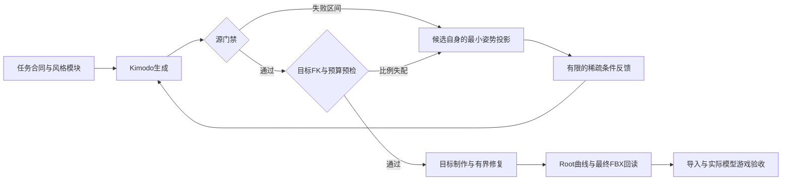

# Mantle 换风格后的制作与修复方法

目标是让动作风格可以替换，接触任务可以复用，并能从失败证据自动定位需要重做的阶段。当前落地范围是已有 ALS Mantle 的单次攀爬、指定支撑侧、原播放时域和名义台沿。改变成无手跃过、换支撑侧、不同接触顺序或任意时长，需要新的任务合同及消费支持，不能只改英文后继续套旧合同。

## 0. 先确认门禁约束的对象

| 类别 | 当前处理 | 判定依据 |
| --- | --- | --- |
| 功能与数值正确性 | 保留固定支撑手、掌面、骨长、有限值、落点、资源身份、最终 FBX、同帧提交／回滚检查 | 与“谨慎／轻盈”等风格无关；端点通过还要检查完整姿态 |
| 目标模型几何 | 保留运行完整蒙皮 2 cm 上限，检查实际显示模型；另检查求解引入的共线和身体净空 | 2 cm 是本项目现有上限，不是所有身体部位的美术合格定义；需要真实模型与场景复验 |
| ALS-v1 兼容 | 保留原 Pelvis 15 cm 管道、固定接触时间及起终姿势要求 | 这是当前消费者合同，不能包装成所有攀爬风格的自然规律。升级时需要新 profile、曲线与消费者能力，而非修改旧失败结论 |
| 修复预算 | 保留源手 8 cm、目标手 10 cm、指节角度等既有边界 | 限制改动量，不保证修复后的关节和蒙皮自然；必须记累计改动，禁止多轮小改绕过总预算 |
| 风格保真 | 独立报告自由关节、姿态、节奏和人工辨识结果 | 功能门禁通过不能证明“轻盈／谨慎”已准确表达；不把原版全身曲线当唯一风格 |

关闭手锁是“接触失效”的负对照，不要求每个模型都同时穿模。用独立预期支撑时域和锚点检查失锁，另保留能触发穿模的几何负对照。不能从关闭后的控制器权重反推“这一帧本来就不需要支撑”。消费端的[具体门禁审计](../../../Godot-Locomotion/docs/verification/2026-10-13-mantle-gate-audit.md)记录了原报告、数值依据和未覆盖项。

## 1. 模块化修改提示词

`mantle_prompt.py` 将文案拆成 `action`、`contact`、`transition` 三个必需模块，以及可增删的 `style` 和 `modifiers`。动作合同另外记录动作、次数、支撑侧和结束双脚支撑；结构化 `requires` 可拒绝显式矛盾。任意自然语言并未被自动语义认证，收据保留 `freeTextSemanticsVerified=false`。

最小规则示例，保存为 `tools/kimodo_pipeline/mantle_my_style_rules.json`：

```json
{
  "extends": "directional_gait_rules.json",
  "mantlePrompt": {
    "schemaVersion": 1,
    "recipe": "default",
    "styles": {
      "my-style": {
        "text": "The person moves cautiously, with deliberate weight shifts and a controlled rise."
      }
    },
    "style": "my-style",
    "modifiers": []
  }
}
```

换风格时先只改 `style`；删除风格用 `style:null`，删除修饰用 `modifiers:[]`。需要不同动词时覆盖 `modules.action`，但保留自足的主体与动作。`motionPromptOverrides[semantic]` 是整句显式覆盖，优先级最高，原来被 Mantle 硬编码吞掉的问题已修复。默认不配置时，旧文案保持逐字一致。

净空问题可以尝试独立的接近修饰，例如 `The hands rise outside the ledge before settling onto its top.`，并声明 `requires: {"handContactRequired": true}`。这是可对照的文案选项，不是已证明能单独清障的保证。若某个fullbody条件已把手固定在台身内，新增这句话不能覆盖冲突条件，必须先修正条件的几何可行性。

先执行 `produce_als_resources.py plan --scope mantle --rules ... --output <新目录>`，检查 `graph.json` 中真正生效的 `params.prompt` 和 `mantlePromptReceipt`。收据包含模块、动作合同和摘要。比较文案时保持模型、种子、时长、采样步数、CFG、约束和后处理一致；比较约束时保持文案一致。单次改善后再换种子，不能把一个幸运种子写成普遍保证。

官方建议适中的细节、一至两个主要行为、每段自足，并避免文案与约束互相矛盾；不宜把每个关节的精确路径全部塞入提示词。[NVIDIA 最佳实践](https://research.nvidia.com/labs/sil/projects/kimodo/docs/key_concepts/limitations.html)

## 2. 从稀疏任务约束到失败反馈

`sparse-contact-v1` 从当前任务的接近、抓沿、支撑、释放和站稳事件构造条件：入口／出口两帧 fullbody、每只支撑手的稀疏位置与掌向、结束双脚和必要的身体轨迹点。它减少原版中间全身姿势约束，不删除最终源／目标门禁。

Kimodo 的手／脚 EE 条件还隐含约束 smoothed root XZ、root Y 和全局朝向；不能称为“只钉手，身体完全自由”。当前 Hips 通用 EE 在原生后处理中没有与手脚相同的硬修正掩码，所以必须检查实际髋部与可达性。非 Root2D 条件保持每类少于20帧；本工具更保守地限制全部条件的时间并集最多19帧。[NVIDIA 约束定义](https://research.nvidia.com/labs/sil/projects/kimodo/docs/key_concepts/constraints.html)

源门禁失败后，`mantle_constraint_feedback.py` 按以下步骤处理：

1. 在完整时间轴分别测量髋部管道偏差、肩到固定腕目标的真实骨长可达性、手位姿和落地脚。按连续失败区间选极值，不能只看一个全局峰值，也不能以“手位置误差不大”替代肩腕可达性。
2. 从失败候选本身的局部旋转开始，优化 root 与参与任务的躯干／肩链，再用固定骨长 IK 满足手或脚目标。目标函数保留候选姿势及自由关节；原版只提供当前合同的锚点和允许管道，不提供替换整姿势。
3. 把投影姿势作为少量新的 Kimodo 条件，重新扩散。投影输出标记 `deliverable=false`；它不能直接冒充新生成动作，也不能绕过最终作者修复预算。
4. 用上一轮实际未约束区间的超长量、相邻肩运动及髋部超调推导下一轮内部余量。内部目标向原门禁以内收紧，验收门槛保持原值。同步同帧其他 EE／Hips 条件，避免条件彼此冲突。
5. 达到19帧并集上限后，可以将同支撑阶段的已有事件升级为投影 fullbody 条件，不能无限增加时间点。达到轮数／姿态修正／可行性预算后停止并保留失败；不得无限重试直到偶然通过。

每轮保存原候选、误差区间、选择原因、改变的关节、root 位移、内部余量、条件和父 NPZ 摘要，以及重新生成后的独立作者结果。已经通过的动作分支继续后续转换，失败分支明确阻断。

源通过后还必须执行 `mantle_target_preflight.py` 的真实目标 FK／原预算检查。不同骨段比例可能让源腕完全贴合，转换后的目标腕却需要超过10 cm的修正。此时 `mantle_target_projection.py` 和 `mantle_target_feedback.py` 在保持源腕位姿的前提下最小调整候选躯干、肩和肘平面，同时预测目标修正量；预测器必须与实际 `offline_retarget.convert` 的 FK 对照一致。将这些候选姿势作为新的生成条件，重新通过源和目标门禁，而不是先偷偷改13 cm，再从一个新起点声称后处理只改了10 cm。

源与目标阶段分别计算归一化失败和停滞；切换阶段后重置该阶段的比较基线。连续两轮未改善时停止，允许一次暂时回退；总反馈轮数另有硬上限。阶段失败、投影不可行或无新目标通过，都保留明确的后续阻断记录。



## 3. 后处理与运行适配各自负责什么

目标制作继续复用现有纯脚本重定向、目标手部有界 IK、实际指节蒙皮避障、Root/Pelvis 分解和控制曲线。主骨／手指修复完成后重建目标实体 twist，再验证最终 raw／FBX 的全骨、全键一致性。修复应最小化对生成姿势的改变，保留未参与问题的关节、Root 所有权、骨长和时间轴；手指与皮肤的整数键通过仍不能代替插值和游戏混合状态检查。

修复条件姿势时也要防止把问题转移到另一部位：本轮把髋部压回允许管道，曾使建立前手部进一步进入台身。投影后的条件必须重查目标几何，不能只验它正在修的那一个指标。固定指姿的斜向腕移动搜索没有找到解，只能说明该自由度组合未找到解；不能据此断言允许的指节／腕／手臂联合空间全部不可行。尝试交替修复时，位移和角度始终相对原输入累计，最后仍用实际LBS和原门禁独立判定。

本轮已落地的通用末次修复是“有界手臂清障之后，再优化实际需要的指节”。腕／掌深陷时，先修指可能没有可行解；手臂移动后，原45°范围内的小幅指节变化却可能足够。算法仅在既有流程仍超门槛时触发，使用原输入作为每根指节的角度基准，真实全手LBS必须不恶化，支撑腕保持固定。先有限尝试更好的净空目标，再尝试原2 cm门槛以内的余量，未达到原门槛仍拒绝。耗时另写telemetry，不混入需要确定性哈希的资产报告；求解次数、选择原因及预算证据可随确定性回执保存。

`mantle_temporal_hand_repair.py`进一步处理“端点安全、帧间切角”：自动寻找失败区间，有限尝试前缘、顶面及斜向退出，再联合优化相邻键的指节。修复只改变允许的关节；不可动的邻帧保持已有合法边界，不能要求它们达到一个优化变量无法实现的更严内部目标。预算始终相对最初raw，在整数键和帧间采样都检查累计腕位移、指节角度及支撑腕保持；发现插值预算超调时，向原输入作有限回缩并重新检验，而不是刷新预算起点。

当前实际采样采用消费端的最短弧归一化线性四元数插值，平移线性插值；按同一接触合同预览获取／释放权重、固定腕掌、过渡抬升和定骨长两骨IK。自由腕的raw深度另外记录，不能把满支撑时本会由IK消除的腕漂移误算成最终皮肤，也不能拿理想刚体锚定代替有限骨长的实际求解。求解网格为0.1帧，独立整片复验为0.025帧，并明确它是有限采样；预览尚不含实际actor高度／进度变换和消费端twist调整，必须继续通过Godot完整蒙皮与全帧0.1 cm可达残差门禁。新v2手部报告必须包含这些采样、原始摘要和累计预算证据。

身体前进曲线的`target-skin-top-or-front-v2`在原2 cm深度硬域内预留0.2 cm，求顶面／前缘的联合可行域，并在原不后退、200 cm/s及落点合同内尽量保留作者前进量。旧0.5 cm正净空算法只作为对照写入报告，不再因一个接近顶面的脚尖把前面整段动作强制大幅后退。所有原身体顶点仍参与计算；它没有修改Root／lift或放宽最终完整蒙皮门禁。更新曲线之后仍要在实际台沿距离、障碍高度及移动平台下验证支撑可达性。

以下问题无法只靠改源 prompt 消除：源臂仍弯曲、短臂显示模型却被运行求解拉到共线；运行模型额外 body correction 在接触切换时突然变化；手 IK 改了主骨后 twist 没跟随。这些要在角色适配层修复，并使用同一角色时间与候选／提交／回滚事务。

也要检查版本之间的控制曲线语义。例如原生动作已用`ViewBlock`阻断视线层，消费图却读取V4的`Mask_AimOffset`和`Enable_SpineRotation`，漏掉适配就会额外改变躯干，破坏制作时的手部几何。应传递原曲线的渐变权重并保留既有阻断，而不是要求每份prompt预先抵消这段运行偏移。

当前 Core 按源动作实际肘弯和目标真实臂长形成软姿态偏好，实际锚点、修正预算和目标身体几何是约束。身体几何从实际蒙皮绑定导出，躯干／头部可在顶面和前缘之间选择可行退出方向；肘弯为净空作必要退让，不能以完全保留一个角度为由穿台。身体修正的时间过渡作用在约束投影之前，最后重解手脚并更新 twist；对最终骨架后置低通会破坏固定支撑。

建立阶段使用逐手接触曲线的未来固定锚点，以当前源肩／源骨长预测完整支撑弯曲，再按目标骨长规划身体。0.2 角色秒的 C2 包络沿已有 montage 时间与 rate 计算，既不提前实际手锁，也不额外推进未来动画图。单靠实际手权重缩小可达球会出现权重趋零、身体偏好却不趋零的问题；建立包络显式作用于完整身体偏好，之后仍由当帧真实接触和几何限制最终结果。

现有身体几何覆盖不受后续四肢 IK 旋转影响的纯身体点。腿部、手部及混合权重点仍由独立完整蒙皮门禁检查，不能称为完整人体避障器。连续关节／接缝形变、可接受速度包络及风格辨识仍需要专门校准和人工验收。

还要验证控制曲线与最终姿势的联合可行性。先用身体皮肤推迟前进，再独立要求腕固定，可能让原本合格的动作在运行时够不到台沿。记录限制身体进度的帧和顶点、支撑肩腕可达范围，以及关键帧之间的实际插值皮肤；不能拿整数关键帧合格替代这些检查。播放时同一物理时间必须落到同一动画采样时间：预定位之后的普通动画推进要计入资产的实际播放倍率，不能固定扣除一个未乘倍率的时间步。

## 日常命令与失败处理

在独立 Pipeline 根目录、已安装 Kimodo 的 Python 环境执行。默认完整执行生成、反馈、转换、曲线、最终 FBX、Godot 导入及运行；输出必须是新目录：

```powershell
& G:/Github/kimodo/.venv/Scripts/python.exe tools/refine_mantle.py `
  --rules tools/kimodo_pipeline/mantle_my_style_rules.json `
  --semantic Mantle_High `
  --output workspace/runs/mantle_my_style_v1 `
  --base-pack workspace/als/assets/generated/YOUR_VERIFIED_BASE/resource-pack.json `
  --max-feedback-rounds 8
```

后端路径以本机 TOML 为准；WSL 使用其自己的 Python 与作者历史。`--semantic` 还支持 `Mantle_Low_Left` 和 `Mantle_Low_Right`。默认完整运行可能因保留包其他缺口或完整矩阵拒绝而返回非零；必须分别读本次动作的源、目标、文件和游戏结果，不能把非零整体结果改写为通过。

已有作者回执的后续续跑使用 `--resume --output <记录graph.json及authoring子目录的轮次目录>`，或提供带 `refinement-state.json` 的制作根目录。该入口校验实际 rules／graph、批次摘要、完整依赖链、节点身份及所有登记载荷；不重新扩散，不隐式采用新 rules。遇到已完成或中断的后续目录时，新建 continuation 保留旧证据，再执行后续阶段；新的基包／运行范围不会被旧结果悄悄忽略。每份运行证书只绑定本次实际执行的代码和范围。

每次只重做最早失效的必要阶段：

| 证据 | 优先处理 |
| --- | --- |
| 动作语义与预期不符，但空间任务可行 | 简化／替换 action 或 style 模块，同条件做对照 |
| 生成手够不到、身体路径或时序错误 | 任务可行性与稀疏反馈条件；必要时新任务 profile |
| 源通过，目标比例／指节／twist 失败 | 目标重定向和有界修复，再出最终 FBX |
| raw／FBX通过，显示模型或动画混合失败 | 消费端比例适配、预备／释放、场景几何及事务 |
| 功能通过，但风格不清晰或被修平 | 对比自由关节与原生成姿势，减少无关约束／修复，人工评审 |

“快速”来自复用已校验的任务合同、模型绑定、上游来源和可定位的失败报告，不来自跳过门禁。当前续跑能避免重复生成；带基包的完整转换仍会重建保留资源的交付配置和执行全量文件检查，其耗时需要单独计入。每次修改 prompt 后至少重新完成受影响资产的全链和相关真实游戏验证。

## 本轮验证入口

实际风格／约束对照、保留的失败、最终交付与覆盖范围见[本批分阶段验证](../../../Godot-Locomotion/docs/verification/2026-10-13-mantle-style-generalization.md)；消费者算法的稳定接口见[模型绑定契约](../../../Godot-Locomotion/docs/architecture/als-character-model-binding.md)。本方法不承诺任意提示词、任意骨架或任意障碍都能自动通过。
